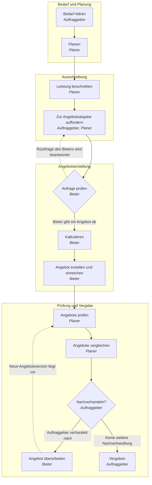
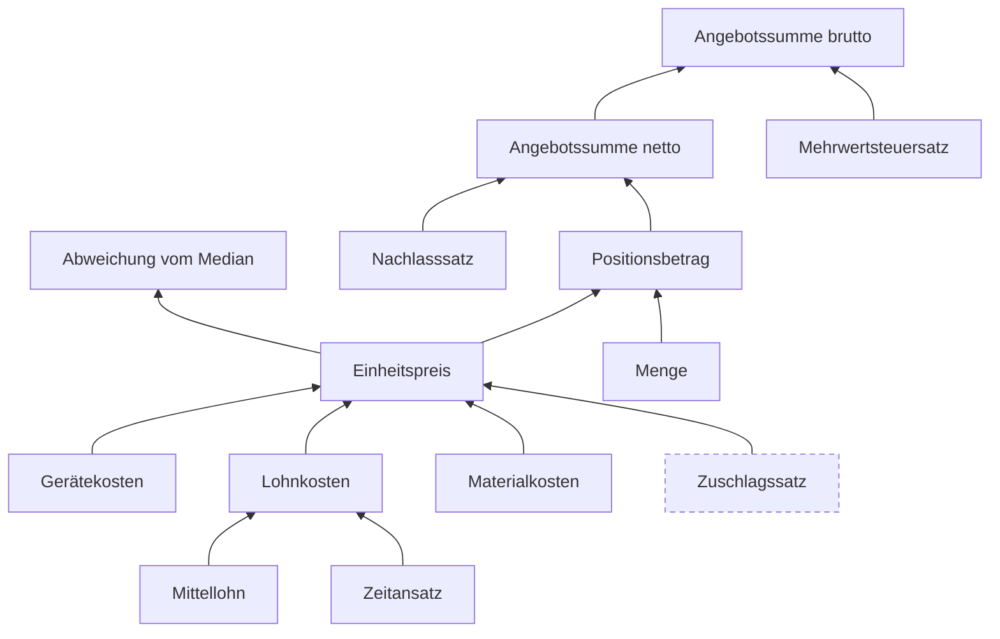

# Diagramme

Automatisch erzeugt mit `python -m mapact.visualize`; nicht von Hand bearbeiten.

## Prozessablauf

Gestrichelte Pfeile führen zurück (Schleifen).

## Wertentstehung

Gestrichelte Kästen beruhen auf Annahmen und warten auf den Experten.

